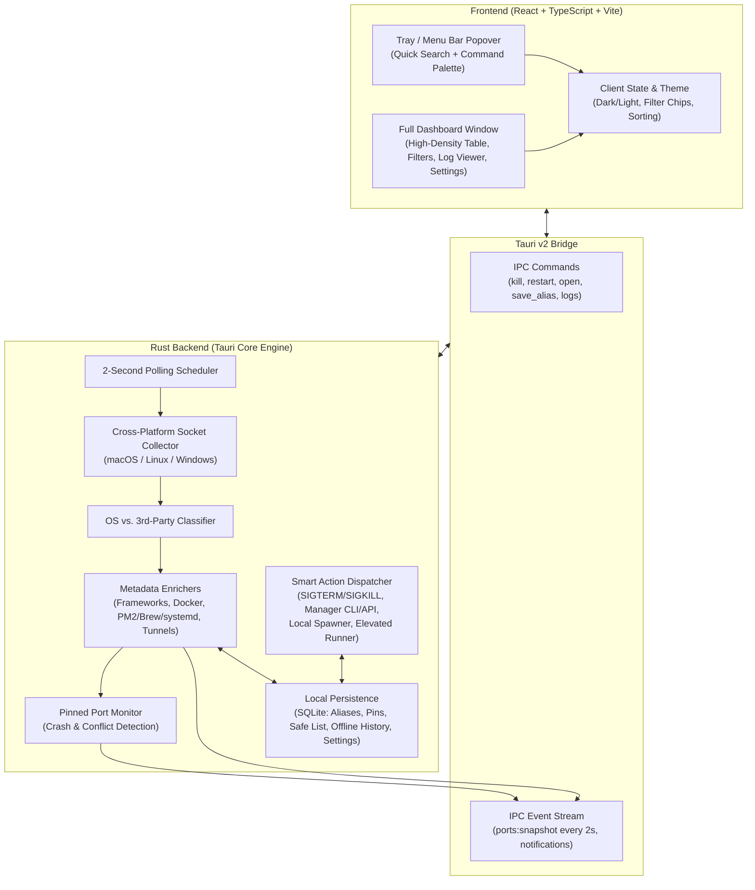

# iPort

> A lightweight, cross-platform desktop command center to inspect, organize, and manage every local port, dev server, Docker container, background service, tunnel, and third-party application running on your machine.

[](#roadmap)
[](#design--architecture-decisions)
[](#tech-stack)

---

## Why iPort?

Modern local development quickly turns your machine into a tangle of listening ports: a Next.js frontend on `3000`, a Python/FastAPI API on `8000`, multiple Docker Compose stacks, background workers under PM2 or Homebrew services, SSH/`kubectl` port-forwards, and dozens of third-party desktop apps quietly holding onto ports in the background.

Tracking down *what* is occupying a port—and stopping or restarting it cleanly without breaking auto-respawning services—usually means juggling `lsof`, `netstat`, `ps`, `docker ps`, and `kill -9`.

**iPort** brings complete visibility and safe, one-click control over every non-OS listening port into a single, ultra-lightweight desktop app.

---

## Design & Architecture Decisions

All foundational product and technical decisions agreed upon for **iPort**:

| Dimension | Decision | Rationale |
| :--- | :--- | :--- |
| **Target Platforms** | **Cross-platform** (macOS, Windows, Linux) | Consistent developer experience across machines and open-source portability. |
| **Tech Stack** | **Tauri v2** (Rust backend + React/TypeScript UI) | Minimal memory/bundle footprint for an always-running utility; fast, safe native OS & socket access in Rust. |
| **App Form Factor** | **Hybrid** (System Tray / Menu Bar popover + Full Dashboard window) | Instant access from the tray/hotkey for quick kills & lookups; full window for deep inspection, logs, and management. |
| **Primary View** | **High-density searchable & sortable single table** + quick filter chips (`All`, `Dev`, `Docker`, `Services`, `Tunnels`, `3rd-Party`, `System`) | Maximum scanability, zero hidden nesting, keyboard-first workflow. |
| **Noise Filtering** | **Hide core OS daemons by default; show ALL third-party installed apps & dev services** (with 1-click `System` toggle) | Eliminates OS noise while guaranteeing visibility into every third-party program occupying a port. |
| **Refresh Strategy** | **Fixed fast polling (2-second interval)** for full snapshots (configurable in settings) | Simple, deterministic architecture; keeps the tray badge, table, and crash/conflict alerts continuously fresh. |
| **UI Language** | **English only** | Clean, unified global developer tool standard. |
| **Visual Design** | **System-adaptive Dark & Light themes** — minimal Linear / Raycast-inspired developer aesthetic | Tabular monospace port numbers, crisp status indicators, high information density, keyboard-first navigation. |

---

## Core Feature Specification

### 1. Universal Port Discovery & Intelligent Classification

- **Local TCP & UDP Port Scanning:**
  - Captures port number, protocol (`TCP`/`UDP`), bind address (`127.0.0.1`, `0.0.0.0`, `::`), state, PID, parent PID, full command line, working directory (CWD / project root), CPU usage, RAM usage, and uptime.
- **Third-Party Application vs. Core OS Classification:**
  - Distinguishes built-in OS system daemons (e.g., macOS `mDNSResponder`/AirPlay, Windows `svchost`/System, Linux core system services) from **any user-installed third-party software** listening on a port (e.g., Ollama, Spotify, Discord RPC, database GUIs, VPN clients, local AI runtimes, custom daemons).
  - Core OS ports are filtered out by default; all third-party installed applications are surfaced by default alongside dev tools, with a single `System` filter chip to reveal OS ports anytime.
- **Smart Framework & Runtime Recognition:**
  - Automatically identifies and badges common stacks from process binary, arguments, and project directory (`package.json`, `pyproject.toml`, `Cargo.toml`, etc.):
    - **Web / JS:** Next.js, Vite, React, Nuxt, Astro, Remix, Express, NestJS, Node.js, Bun, Deno
    - **Python:** FastAPI, Uvicorn, Gunicorn, Django, Flask, Streamlit, Jupyter
    - **Systems & Backend:** Go, Rust, Ruby/Rails, Java/Spring Boot, .NET, PHP
    - **Data & Infra:** PostgreSQL, MySQL/MariaDB, MongoDB, Redis, Elasticsearch, RabbitMQ, MinIO
- **Docker & Docker Compose Integration:**
  - Connects directly to the local Docker Engine socket / named pipe to resolve container name, image, health/status, Docker Compose project & service labels, and exact `host:container` port mappings.
- **Background Service Managers:**
  - Detects ports owned by **PM2**, **Homebrew Services** (macOS), **systemd** (Linux), **launchd** (macOS), and **Windows Services** so they are clearly labeled with their managing supervisor.
- **Tunnels & Port-Forwards:**
  - Detects and parses **SSH tunnels** (`-L`, `-R`, `-D`), **`kubectl port-forward`** (cluster/namespace/pod/service), **ngrok**, and **cloudflared** tunnels.

### 2. Safe Management & Developer Actions

- **Smart Manager-Aware Stop & Kill:**
  - Avoids raw `kill -9` on supervised services that immediately auto-respawn:
    - **Standard processes:** Graceful Stop (`SIGTERM`) and Force Kill (`SIGKILL` / `TerminateProcess`)
    - **Docker:** `docker stop` / `docker restart` (individual container or entire Compose project)
    - **PM2:** `pm2 stop` / `pm2 restart`
    - **Homebrew Services:** `brew services stop` / `brew services restart`
    - **systemd / launchd / Windows Services:** Native service manager stop & restart commands
- **Quick Developer Actions:**
  - Open port in default browser (`http://localhost:<port>` / `https://...`)
  - Copy URL or port number to clipboard
  - Reveal working directory in Finder / File Explorer / Files
  - Open project directory directly in preferred IDE (VS Code, Cursor, JetBrains, etc.)
- **Docker & Service Logs:**
  - View recent and streaming stdout/stderr logs for Docker containers, Compose services, and supported service managers directly inside the Dashboard.
- **Local Dev Server Restart (Offline History):**
  - Records the command, working directory, and launch context of stopped local dev servers (e.g., `npm run dev`, `uvicorn main:app --reload`).
  - Stopped pinned/recent servers remain visible as dimmed **Offline** rows and can be restarted in one click.
- **Root / Admin Elevated Actions:**
  - Safely terminate or stop root/Administrator-owned ports via native OS privilege escalation prompts (macOS Authorization, Linux `pkexec`/`sudo`, Windows UAC).

### 3. Power-User Workflow & Local Persistence

- **Custom Aliases & Pinned Favorites:**
  - Assign friendly names/labels to ports or services (e.g., `3000` → *"Admin Dashboard"*) and pin important services to the top of the table.
- **Global Keyboard Shortcut (Command Palette Mode):**
  - Summon iPort from anywhere on the OS via a configurable hotkey (e.g., `Cmd/Ctrl + Shift + P`) to instantly search, jump to browser, or stop a port entirely from the keyboard.
- **Protected Ports (Safe List):**
  - Mark critical ports/services (e.g., PostgreSQL `5432`, SSH `22`, Redis `6379`) as protected to block accidental kills or require explicit confirmation.
- **Launch at Login & Live Tray Badge:**
  - Automatically start iPort in the background on system startup and show the live active non-OS port count directly on the System Tray / Menu Bar icon.
- **Port Conflict & Crash Notifications:**
  - Send native OS notifications when a pinned/watched service goes down unexpectedly or when a different process claims a pinned port.

---

## Technical Architecture

### System Overview



### Tech Stack

- **Desktop Shell & Backend:**
  - [Tauri v2](https://v2.tauri.app/) (Rust)
  - `tauri-plugin-global-shortcut`, `tauri-plugin-autostart`, `tauri-plugin-notification`, `tauri-plugin-opener`, `tauri-plugin-shell`
  - **System & Sockets:** `sysinfo`, `netstat2` / `listeners` (plus native OS fallbacks where needed for CWD & command args)
  - **Docker API:** `bollard` (async Docker Engine client over Unix socket / Windows named pipe)
  - **Persistence:** `rusqlite` (embedded SQLite database in app config dir)
- **Frontend:**
  - React 19 + TypeScript + Vite
  - Tailwind CSS (system Dark/Light design tokens)
  - TanStack Table (high-density sorting, filtering, keyboard row selection)
  - Lucide Icons + custom crisp stack/framework icons

### Cross-Platform OS Strategy

| Capability | macOS | Linux | Windows |
| :--- | :--- | :--- | :--- |
| **Port & PID Scanning** | `libproc` / `listeners` / `lsof` fallback | `/proc/net/tcp*`, `/proc/net/udp*`, `/proc/<pid>/fd` | Win32 IP Helper API (`GetExtendedTcpTable` / `GetExtendedUdpTable`) |
| **OS vs. 3rd-Party Detection** | Code signing / bundle path (`/System/*`, `/usr/libexec/*` vs `/Applications/*`, Homebrew, user bins) | Binary path + systemd vendor unit vs user/third-party packages (`/opt`, `/usr/local`, `~/.local`, snap/flatpak) | Binary path & publisher (`C:\Windows\System32` Microsoft-signed vs Program Files, AppData, user bins) |
| **Service Managers** | Homebrew Services, `launchd`, PM2 | `systemd`, PM2 | Windows Services (`sc`/Win32), PM2 |
| **Docker Engine** | `/var/run/docker.sock` (Docker Desktop, OrbStack, Colima, Rancher) | `/var/run/docker.sock` / rootless socket | `//./pipe/docker_engine` |
| **Privilege Escalation** | Native macOS Authorization (`osascript` / `SMJobBless`) | `pkexec` / Polkit | Windows UAC (`ShellExecuteW` `runas`) |

### Planned Repository Structure

```text
iPort/
├── src/                        # React + TypeScript frontend
│   ├── components/
│   │   ├── table/              # High-density port table, columns, filter chips
│   │   ├── popover/            # Compact tray popover & command palette UI
│   │   ├── logs/               # Container & local process log viewer drawer
│   │   └── settings/           # Polling interval, hotkeys, IDE, safe list UI
│   ├── hooks/                  # Tauri IPC event hooks & keyboard navigation
│   ├── store/                  # UI state, filters, optimistic actions
│   ├── types/                  # Shared PortEntry, Action, Settings TS models
│   └── styles/                 # Dark/Light theme tokens (Linear/Raycast style)
├── src-tauri/                  # Rust backend
│   └── src/
│       ├── scanner/            # OS-specific TCP/UDP + process collectors
│       ├── classifier/         # Core OS vs 3rd-party app ruleset
│       ├── enrichers/          # Framework, Docker (bollard), Services, Tunnels
│       ├── actions/            # Smart stop/kill, local restart, elevated runner
│       ├── monitor/            # 2s polling loop + crash/conflict detector
│       ├── storage/            # SQLite migrations & repository layer
│       ├── tray.rs             # System tray / menu bar + live badge counter
│       └── commands.rs         # Tauri IPC command handlers
└── README.md
```

---

## Roadmap

### Phase 0 — Foundation & Project Setup
- [ ] Initialize Tauri v2 + React + TypeScript + Vite + Tailwind CSS workspace
- [ ] Configure shared domain data models (`PortEntry`, `SourceType`, `AppCategory`, `ServiceManager`, `ManagedAction`) across Rust and TypeScript
- [ ] Set up design system tokens (Dark & Light system-adaptive themes, monospace port badges, keyboard focus rings)
- [ ] Add GitHub Actions CI matrix to validate Rust & frontend builds across macOS, Linux, and Windows

### Phase 1 — MVP: Core Port Scanner, 3rd-Party Classification & High-Density Table
- [ ] Implement cross-platform TCP & UDP listening port collector (port, protocol, bind address, PID, parent PID, command line, CWD, CPU, RAM, uptime)
- [ ] Implement fixed **2-second polling loop** emitting normalized snapshots to the UI
- [ ] Build **OS vs. 3rd-Party Classifier** for macOS, Linux, and Windows (hide core OS daemons by default; surface all third-party installed programs)
- [ ] Build **Smart Framework & Runtime Detector** (Next.js, Vite, React, Node/Bun/Deno, Python/FastAPI/Uvicorn/Django/Flask, Go, Rust, Postgres, Redis, MongoDB, etc.)
- [ ] Build the **High-Density Dashboard Table** with instant search, multi-column sorting, and quick filter chips (`All`, `Dev`, `Docker`, `Services`, `Tunnels`, `3rd-Party`, `System`)
- [ ] Implement **Quick Developer Actions**: Open in Browser (`http`/`https`), Copy URL/Port, Reveal Project Folder, Open in IDE (VS Code / Cursor / custom)
- [ ] Implement basic local process controls: Graceful Stop (`SIGTERM`) and Force Kill (`SIGKILL`)

### Phase 2 — Hybrid UX: System Tray Popover, Live Badge & Global Hotkey
- [ ] Implement System Tray / Menu Bar integration with live **active non-OS port count badge**
- [ ] Build compact **Tray Popover** optimized for rapid lookup, 1-click browser open, and quick stop/kill
- [ ] Add seamless toggle between Tray Popover and Full Dashboard window (keep app running in background when Dashboard is closed)
- [ ] Implement **Global Keyboard Shortcut** (Command Palette mode, e.g., `Cmd/Ctrl + Shift + P`) with full arrow-key + Enter/shortcut navigation
- [ ] Add **Launch at Login** support via `tauri-plugin-autostart`

### Phase 3 — Docker & Docker Compose Integration
- [ ] Integrate `bollard` to connect to Docker Desktop, OrbStack, Colima, Rancher Desktop, and native Linux Docker Engine
- [ ] Correlate host listening ports (`docker-proxy` / `vpnkit` / VM forwarders) with actual Docker container metadata (container name, image, status, `host:container` port mapping)
- [ ] Detect Docker Compose labels (`com.docker.compose.project`, `com.docker.compose.service`) and surface stack context in the table
- [ ] Implement **Docker lifecycle controls**: stop/restart single container or entire Compose stack
- [ ] Build integrated **Log Viewer** drawer in the Dashboard for streaming & searching container logs

### Phase 4 — Background Service Managers & Tunnels
- [ ] **PM2 Integration:** Detect PM2-managed processes, app names, cluster instances, and wire up `pm2 stop` / `pm2 restart` + log tailing
- [ ] **OS Service Managers:** Detect and cleanly manage **Homebrew Services** (macOS), **systemd** (Linux), **launchd** (macOS), and **Windows Services** to prevent unwanted auto-respawn on stop
- [ ] **Tunnel & Port-Forward Detection:**
  - Parse **SSH tunnels** (`-L`, `-R`, `-D`) to show remote target host & port
  - Parse **`kubectl port-forward`** commands to display namespace, pod/service, and target port
  - Detect **ngrok** and **cloudflared** tunnels (including local inspection API for public tunnel URLs where available)

### Phase 5 — Persistence, Offline Restart, Safe List & Elevated Controls
- [ ] Set up embedded **SQLite storage** for user state and preferences
- [ ] Implement **Custom Aliases & Pinned Favorites** (pin to top, custom names, quick tags)
- [ ] Implement **Offline History & One-Click Local Dev Server Restart:**
  - Persist command, CWD, and shell context when stopping local dev servers
  - Display stopped pinned/recent servers as dimmed **Offline** rows
  - Spawn managed background process on restart with built-in stdout/stderr log capture
- [ ] Implement **Protected Ports (Safe List):** Lock/unlock critical ports (`5432`, `22`, `6379`, etc.) with confirmation guardrails against accidental termination
- [ ] Implement **Port Conflict & Crash Notifications:** Monitor pinned ports across 2s snapshots and trigger native OS notifications on unexpected crashes or PID/owner changes
- [ ] Implement **Root / Admin Elevated Kill** via native OS elevation prompts (macOS Authorization, Linux `pkexec`, Windows UAC)

### Phase 6 — Polish, Settings, Packaging & Release
- [ ] Build comprehensive **Settings Panel**: configurable polling interval, default IDE selector, global shortcut customization, OS-noise allow/deny overrides, default safe list, theme override (`System` / `Dark` / `Light`)
- [ ] Optimize memory & CPU overhead under heavy port loads (100+ listening sockets & multi-container stacks)
- [ ] Configure cross-platform release pipelines & installers (`.dmg` for macOS Apple Silicon & Intel, `.msi`/`.exe` for Windows, `.AppImage`/`.deb` for Linux)
- [ ] Add code signing, notarization, and in-app auto-updater
- [ ] Write user documentation, keyboard shortcut cheatsheet, and troubleshooting guide

---

## Status

Currently in the **design & planning phase**. All core architectural decisions and phased milestones are documented above—next step is initializing Phase 0 (Tauri v2 + React/TypeScript scaffold).
